# The screens

The 154 screens of the 60 stages, one by one, as the cartridge draws them: 14 stages have one screen, 16 have two, 16 three, 12 four and 2 six. MSX2 on the left, MSX on the right.

## Stage 1

<figure>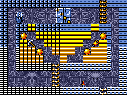<figcaption>Screen 1 - MSX2</figcaption></figure>
<figure>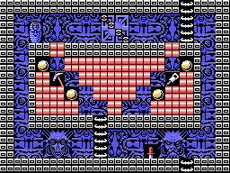<figcaption>Screen 1 - MSX</figcaption></figure>

## Stage 2

<figure><figcaption>Screen 1 - MSX2</figcaption></figure>
<figure><figcaption>Screen 1 - MSX</figcaption></figure>

## Stage 3

<figure>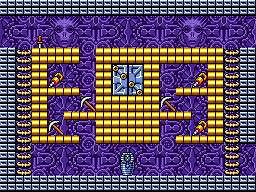<figcaption>Screen 1 - MSX2</figcaption></figure>
<figure>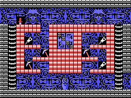<figcaption>Screen 1 - MSX</figcaption></figure>

<figure>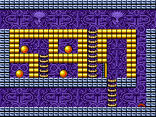<figcaption>Screen 2 - MSX2</figcaption></figure>
<figure>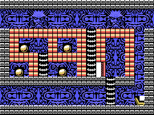<figcaption>Screen 2 - MSX</figcaption></figure>

## Stage 4

<figure>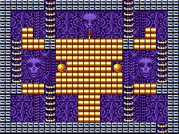<figcaption>Screen 1 - MSX2</figcaption></figure>
<figure>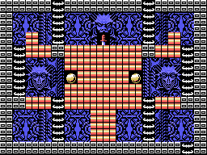<figcaption>Screen 1 - MSX</figcaption></figure>

<figure>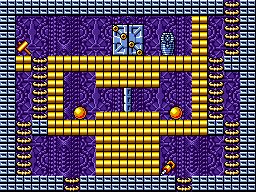<figcaption>Screen 2 - MSX2</figcaption></figure>
<figure>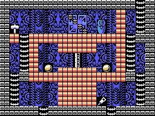<figcaption>Screen 2 - MSX</figcaption></figure>

## Stage 5

<figure>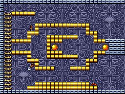<figcaption>Screen 1 - MSX2</figcaption></figure>
<figure>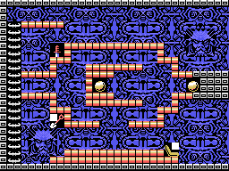<figcaption>Screen 1 - MSX</figcaption></figure>

<figure>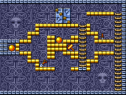<figcaption>Screen 2 - MSX2</figcaption></figure>
<figure>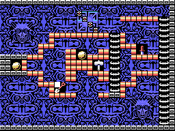<figcaption>Screen 2 - MSX</figcaption></figure>

## Stage 6

<figure>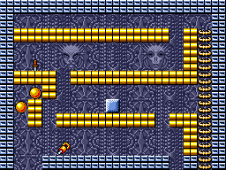<figcaption>Screen 1 - MSX2</figcaption></figure>
<figure>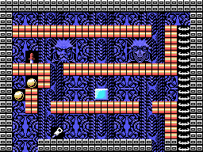<figcaption>Screen 1 - MSX</figcaption></figure>

<figure>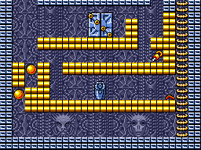<figcaption>Screen 2 - MSX2</figcaption></figure>
<figure>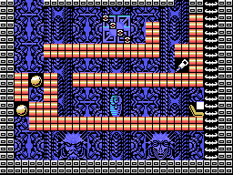<figcaption>Screen 2 - MSX</figcaption></figure>

## Stage 7

<figure>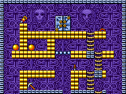<figcaption>Screen 1 - MSX2</figcaption></figure>
<figure>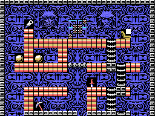<figcaption>Screen 1 - MSX</figcaption></figure>

<figure>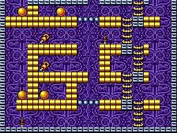<figcaption>Screen 2 - MSX2</figcaption></figure>
<figure>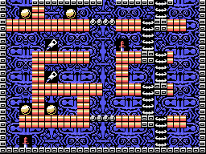<figcaption>Screen 2 - MSX</figcaption></figure>

## Stage 8

<figure>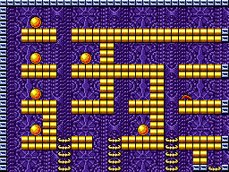<figcaption>Screen 1 - MSX2</figcaption></figure>
<figure>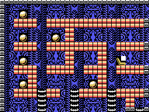<figcaption>Screen 1 - MSX</figcaption></figure>

<figure>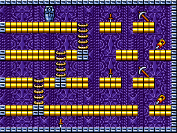<figcaption>Screen 2 - MSX2</figcaption></figure>
<figure>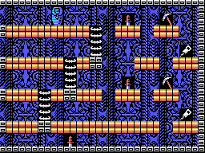<figcaption>Screen 2 - MSX</figcaption></figure>

<figure>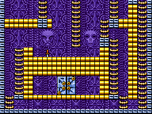<figcaption>Screen 3 - MSX2</figcaption></figure>
<figure>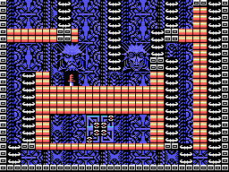<figcaption>Screen 3 - MSX</figcaption></figure>

## Stage 9

<figure>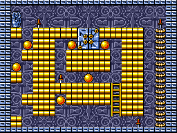<figcaption>Screen 1 - MSX2</figcaption></figure>
<figure><figcaption>Screen 1 - MSX</figcaption></figure>

## Stage 10

<figure>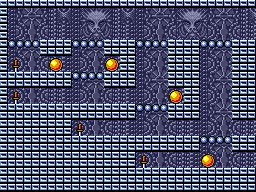<figcaption>Screen 1 - MSX2</figcaption></figure>
<figure>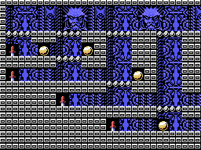<figcaption>Screen 1 - MSX</figcaption></figure>

<figure>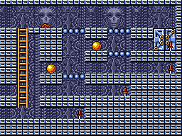<figcaption>Screen 2 - MSX2</figcaption></figure>
<figure>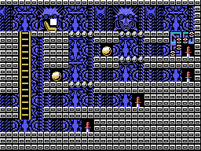<figcaption>Screen 2 - MSX</figcaption></figure>

## Stage 11

<figure>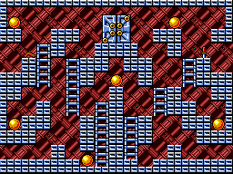<figcaption>Screen 1 - MSX2</figcaption></figure>
<figure>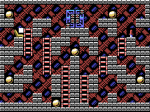<figcaption>Screen 1 - MSX</figcaption></figure>

## Stage 12

<figure>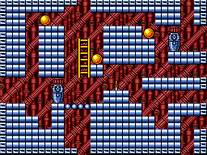<figcaption>Screen 1 - MSX2</figcaption></figure>
<figure>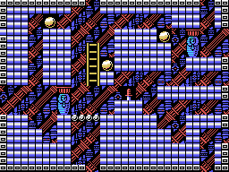<figcaption>Screen 1 - MSX</figcaption></figure>

<figure>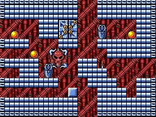<figcaption>Screen 2 - MSX2</figcaption></figure>
<figure>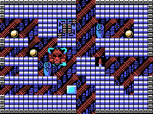<figcaption>Screen 2 - MSX</figcaption></figure>

## Stage 13

<figure>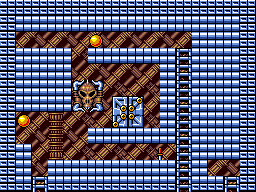<figcaption>Screen 1 - MSX2</figcaption></figure>
<figure>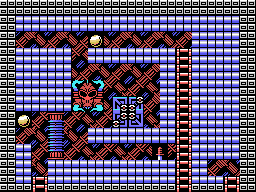<figcaption>Screen 1 - MSX</figcaption></figure>

<figure>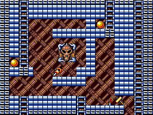<figcaption>Screen 2 - MSX2</figcaption></figure>
<figure>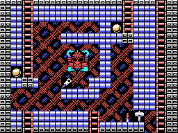<figcaption>Screen 2 - MSX</figcaption></figure>

<figure>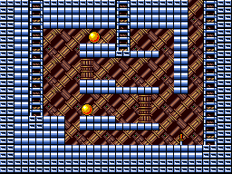<figcaption>Screen 3 - MSX2</figcaption></figure>
<figure>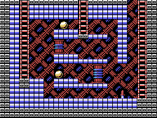<figcaption>Screen 3 - MSX</figcaption></figure>

## Stage 14

<figure>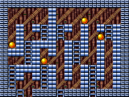<figcaption>Screen 1 - MSX2</figcaption></figure>
<figure>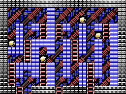<figcaption>Screen 1 - MSX</figcaption></figure>

<figure>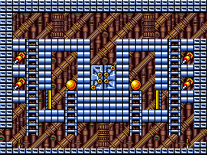<figcaption>Screen 2 - MSX2</figcaption></figure>
<figure>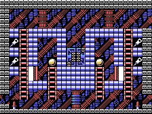<figcaption>Screen 2 - MSX</figcaption></figure>

<figure>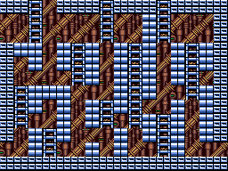<figcaption>Screen 3 - MSX2</figcaption></figure>
<figure><figcaption>Screen 3 - MSX</figcaption></figure>

## Stage 15

<figure><figcaption>Screen 1 - MSX2</figcaption></figure>
<figure><figcaption>Screen 1 - MSX</figcaption></figure>

<figure><figcaption>Screen 2 - MSX2</figcaption></figure>
<figure><figcaption>Screen 2 - MSX</figcaption></figure>

<figure><figcaption>Screen 3 - MSX2</figcaption></figure>
<figure><figcaption>Screen 3 - MSX</figcaption></figure>

## Stage 16

<figure><figcaption>Screen 1 - MSX2</figcaption></figure>
<figure><figcaption>Screen 1 - MSX</figcaption></figure>

<figure><figcaption>Screen 2 - MSX2</figcaption></figure>
<figure><figcaption>Screen 2 - MSX</figcaption></figure>

## Stage 17

<figure><figcaption>Screen 1 - MSX2</figcaption></figure>
<figure><figcaption>Screen 1 - MSX</figcaption></figure>

<figure><figcaption>Screen 2 - MSX2</figcaption></figure>
<figure><figcaption>Screen 2 - MSX</figcaption></figure>

<figure><figcaption>Screen 3 - MSX2</figcaption></figure>
<figure><figcaption>Screen 3 - MSX</figcaption></figure>

## Stage 18

<figure><figcaption>Screen 1 - MSX2</figcaption></figure>
<figure><figcaption>Screen 1 - MSX</figcaption></figure>

<figure><figcaption>Screen 2 - MSX2</figcaption></figure>
<figure><figcaption>Screen 2 - MSX</figcaption></figure>

<figure><figcaption>Screen 3 - MSX2</figcaption></figure>
<figure><figcaption>Screen 3 - MSX</figcaption></figure>

## Stage 19

<figure><figcaption>Screen 1 - MSX2</figcaption></figure>
<figure><figcaption>Screen 1 - MSX</figcaption></figure>

## Stage 20

<figure><figcaption>Screen 1 - MSX2</figcaption></figure>
<figure><figcaption>Screen 1 - MSX</figcaption></figure>

<figure><figcaption>Screen 2 - MSX2</figcaption></figure>
<figure><figcaption>Screen 2 - MSX</figcaption></figure>

## Stage 21

<figure><figcaption>Screen 1 - MSX2</figcaption></figure>
<figure><figcaption>Screen 1 - MSX</figcaption></figure>

## Stage 22

<figure><figcaption>Screen 1 - MSX2</figcaption></figure>
<figure><figcaption>Screen 1 - MSX</figcaption></figure>

<figure><figcaption>Screen 2 - MSX2</figcaption></figure>
<figure><figcaption>Screen 2 - MSX</figcaption></figure>

<figure><figcaption>Screen 3 - MSX2</figcaption></figure>
<figure><figcaption>Screen 3 - MSX</figcaption></figure>

## Stage 23

<figure><figcaption>Screen 1 - MSX2</figcaption></figure>
<figure><figcaption>Screen 1 - MSX</figcaption></figure>

<figure><figcaption>Screen 2 - MSX2</figcaption></figure>
<figure><figcaption>Screen 2 - MSX</figcaption></figure>

<figure><figcaption>Screen 3 - MSX2</figcaption></figure>
<figure><figcaption>Screen 3 - MSX</figcaption></figure>

<figure><figcaption>Screen 4 - MSX2</figcaption></figure>
<figure><figcaption>Screen 4 - MSX</figcaption></figure>

## Stage 24

<figure><figcaption>Screen 1 - MSX2</figcaption></figure>
<figure><figcaption>Screen 1 - MSX</figcaption></figure>

<figure><figcaption>Screen 2 - MSX2</figcaption></figure>
<figure><figcaption>Screen 2 - MSX</figcaption></figure>

<figure><figcaption>Screen 3 - MSX2</figcaption></figure>
<figure><figcaption>Screen 3 - MSX</figcaption></figure>

<figure><figcaption>Screen 4 - MSX2</figcaption></figure>
<figure><figcaption>Screen 4 - MSX</figcaption></figure>

## Stage 25

<figure><figcaption>Screen 1 - MSX2</figcaption></figure>
<figure><figcaption>Screen 1 - MSX</figcaption></figure>

## Stage 26

<figure><figcaption>Screen 1 - MSX2</figcaption></figure>
<figure><figcaption>Screen 1 - MSX</figcaption></figure>

<figure><figcaption>Screen 2 - MSX2</figcaption></figure>
<figure><figcaption>Screen 2 - MSX</figcaption></figure>

<figure><figcaption>Screen 3 - MSX2</figcaption></figure>
<figure><figcaption>Screen 3 - MSX</figcaption></figure>

## Stage 27

<figure><figcaption>Screen 1 - MSX2</figcaption></figure>
<figure><figcaption>Screen 1 - MSX</figcaption></figure>

<figure><figcaption>Screen 2 - MSX2</figcaption></figure>
<figure><figcaption>Screen 2 - MSX</figcaption></figure>

<figure><figcaption>Screen 3 - MSX2</figcaption></figure>
<figure><figcaption>Screen 3 - MSX</figcaption></figure>

## Stage 28

<figure><figcaption>Screen 1 - MSX2</figcaption></figure>
<figure><figcaption>Screen 1 - MSX</figcaption></figure>

<figure><figcaption>Screen 2 - MSX2</figcaption></figure>
<figure><figcaption>Screen 2 - MSX</figcaption></figure>

<figure><figcaption>Screen 3 - MSX2</figcaption></figure>
<figure><figcaption>Screen 3 - MSX</figcaption></figure>

## Stage 29

<figure><figcaption>Screen 1 - MSX2</figcaption></figure>
<figure><figcaption>Screen 1 - MSX</figcaption></figure>

## Stage 30

<figure><figcaption>Screen 1 - MSX2</figcaption></figure>
<figure><figcaption>Screen 1 - MSX</figcaption></figure>

<figure><figcaption>Screen 2 - MSX2</figcaption></figure>
<figure><figcaption>Screen 2 - MSX</figcaption></figure>

## Stage 31

<figure><figcaption>Screen 1 - MSX2</figcaption></figure>
<figure><figcaption>Screen 1 - MSX</figcaption></figure>

## Stage 32

<figure><figcaption>Screen 1 - MSX2</figcaption></figure>
<figure><figcaption>Screen 1 - MSX</figcaption></figure>

<figure><figcaption>Screen 2 - MSX2</figcaption></figure>
<figure><figcaption>Screen 2 - MSX</figcaption></figure>

<figure><figcaption>Screen 3 - MSX2</figcaption></figure>
<figure><figcaption>Screen 3 - MSX</figcaption></figure>

## Stage 33

<figure><figcaption>Screen 1 - MSX2</figcaption></figure>
<figure><figcaption>Screen 1 - MSX</figcaption></figure>

<figure><figcaption>Screen 2 - MSX2</figcaption></figure>
<figure><figcaption>Screen 2 - MSX</figcaption></figure>

<figure><figcaption>Screen 3 - MSX2</figcaption></figure>
<figure><figcaption>Screen 3 - MSX</figcaption></figure>

## Stage 34

<figure><figcaption>Screen 1 - MSX2</figcaption></figure>
<figure><figcaption>Screen 1 - MSX</figcaption></figure>

<figure><figcaption>Screen 2 - MSX2</figcaption></figure>
<figure><figcaption>Screen 2 - MSX</figcaption></figure>

<figure><figcaption>Screen 3 - MSX2</figcaption></figure>
<figure><figcaption>Screen 3 - MSX</figcaption></figure>

<figure><figcaption>Screen 4 - MSX2</figcaption></figure>
<figure><figcaption>Screen 4 - MSX</figcaption></figure>

## Stage 35

<figure><figcaption>Screen 1 - MSX2</figcaption></figure>
<figure><figcaption>Screen 1 - MSX</figcaption></figure>

<figure><figcaption>Screen 2 - MSX2</figcaption></figure>
<figure><figcaption>Screen 2 - MSX</figcaption></figure>

<figure><figcaption>Screen 3 - MSX2</figcaption></figure>
<figure><figcaption>Screen 3 - MSX</figcaption></figure>

<figure><figcaption>Screen 4 - MSX2</figcaption></figure>
<figure><figcaption>Screen 4 - MSX</figcaption></figure>

## Stage 36

<figure><figcaption>Screen 1 - MSX2</figcaption></figure>
<figure><figcaption>Screen 1 - MSX</figcaption></figure>

<figure><figcaption>Screen 2 - MSX2</figcaption></figure>
<figure><figcaption>Screen 2 - MSX</figcaption></figure>

<figure><figcaption>Screen 3 - MSX2</figcaption></figure>
<figure><figcaption>Screen 3 - MSX</figcaption></figure>

<figure><figcaption>Screen 4 - MSX2</figcaption></figure>
<figure><figcaption>Screen 4 - MSX</figcaption></figure>

## Stage 37

<figure><figcaption>Screen 1 - MSX2</figcaption></figure>
<figure><figcaption>Screen 1 - MSX</figcaption></figure>

<figure><figcaption>Screen 2 - MSX2</figcaption></figure>
<figure><figcaption>Screen 2 - MSX</figcaption></figure>

<figure><figcaption>Screen 3 - MSX2</figcaption></figure>
<figure><figcaption>Screen 3 - MSX</figcaption></figure>

<figure><figcaption>Screen 4 - MSX2</figcaption></figure>
<figure><figcaption>Screen 4 - MSX</figcaption></figure>

## Stage 38

<figure><figcaption>Screen 1 - MSX2</figcaption></figure>
<figure><figcaption>Screen 1 - MSX</figcaption></figure>

<figure><figcaption>Screen 2 - MSX2</figcaption></figure>
<figure><figcaption>Screen 2 - MSX</figcaption></figure>

<figure><figcaption>Screen 3 - MSX2</figcaption></figure>
<figure><figcaption>Screen 3 - MSX</figcaption></figure>

<figure><figcaption>Screen 4 - MSX2</figcaption></figure>
<figure><figcaption>Screen 4 - MSX</figcaption></figure>

## Stage 39

<figure><figcaption>Screen 1 - MSX2</figcaption></figure>
<figure><figcaption>Screen 1 - MSX</figcaption></figure>

## Stage 40

<figure><figcaption>Screen 1 - MSX2</figcaption></figure>
<figure><figcaption>Screen 1 - MSX</figcaption></figure>

<figure><figcaption>Screen 2 - MSX2</figcaption></figure>
<figure><figcaption>Screen 2 - MSX</figcaption></figure>

<figure><figcaption>Screen 3 - MSX2</figcaption></figure>
<figure><figcaption>Screen 3 - MSX</figcaption></figure>

<figure><figcaption>Screen 4 - MSX2</figcaption></figure>
<figure><figcaption>Screen 4 - MSX</figcaption></figure>

## Stage 41

<figure><figcaption>Screen 1 - MSX2</figcaption></figure>
<figure><figcaption>Screen 1 - MSX</figcaption></figure>

## Stage 42

<figure><figcaption>Screen 1 - MSX2</figcaption></figure>
<figure><figcaption>Screen 1 - MSX</figcaption></figure>

<figure><figcaption>Screen 2 - MSX2</figcaption></figure>
<figure><figcaption>Screen 2 - MSX</figcaption></figure>

## Stage 43

<figure><figcaption>Screen 1 - MSX2</figcaption></figure>
<figure><figcaption>Screen 1 - MSX</figcaption></figure>

<figure><figcaption>Screen 2 - MSX2</figcaption></figure>
<figure><figcaption>Screen 2 - MSX</figcaption></figure>

<figure><figcaption>Screen 3 - MSX2</figcaption></figure>
<figure><figcaption>Screen 3 - MSX</figcaption></figure>

<figure><figcaption>Screen 4 - MSX2</figcaption></figure>
<figure><figcaption>Screen 4 - MSX</figcaption></figure>

## Stage 44

<figure><figcaption>Screen 1 - MSX2</figcaption></figure>
<figure><figcaption>Screen 1 - MSX</figcaption></figure>

<figure><figcaption>Screen 2 - MSX2</figcaption></figure>
<figure><figcaption>Screen 2 - MSX</figcaption></figure>

<figure><figcaption>Screen 3 - MSX2</figcaption></figure>
<figure><figcaption>Screen 3 - MSX</figcaption></figure>

<figure><figcaption>Screen 4 - MSX2</figcaption></figure>
<figure><figcaption>Screen 4 - MSX</figcaption></figure>

<figure><figcaption>Screen 5 - MSX2</figcaption></figure>
<figure><figcaption>Screen 5 - MSX</figcaption></figure>

<figure><figcaption>Screen 6 - MSX2</figcaption></figure>
<figure><figcaption>Screen 6 - MSX</figcaption></figure>

## Stage 45

<figure><figcaption>Screen 1 - MSX2</figcaption></figure>
<figure><figcaption>Screen 1 - MSX</figcaption></figure>

<figure><figcaption>Screen 2 - MSX2</figcaption></figure>
<figure><figcaption>Screen 2 - MSX</figcaption></figure>

<figure><figcaption>Screen 3 - MSX2</figcaption></figure>
<figure><figcaption>Screen 3 - MSX</figcaption></figure>

## Stage 46

<figure><figcaption>Screen 1 - MSX2</figcaption></figure>
<figure><figcaption>Screen 1 - MSX</figcaption></figure>

<figure><figcaption>Screen 2 - MSX2</figcaption></figure>
<figure><figcaption>Screen 2 - MSX</figcaption></figure>

<figure><figcaption>Screen 3 - MSX2</figcaption></figure>
<figure><figcaption>Screen 3 - MSX</figcaption></figure>

<figure><figcaption>Screen 4 - MSX2</figcaption></figure>
<figure><figcaption>Screen 4 - MSX</figcaption></figure>

## Stage 47

<figure><figcaption>Screen 1 - MSX2</figcaption></figure>
<figure><figcaption>Screen 1 - MSX</figcaption></figure>

<figure><figcaption>Screen 2 - MSX2</figcaption></figure>
<figure><figcaption>Screen 2 - MSX</figcaption></figure>

<figure><figcaption>Screen 3 - MSX2</figcaption></figure>
<figure><figcaption>Screen 3 - MSX</figcaption></figure>

## Stage 48

<figure><figcaption>Screen 1 - MSX2</figcaption></figure>
<figure><figcaption>Screen 1 - MSX</figcaption></figure>

<figure><figcaption>Screen 2 - MSX2</figcaption></figure>
<figure><figcaption>Screen 2 - MSX</figcaption></figure>

<figure><figcaption>Screen 3 - MSX2</figcaption></figure>
<figure><figcaption>Screen 3 - MSX</figcaption></figure>

## Stage 49

<figure><figcaption>Screen 1 - MSX2</figcaption></figure>
<figure><figcaption>Screen 1 - MSX</figcaption></figure>

## Stage 50

<figure><figcaption>Screen 1 - MSX2</figcaption></figure>
<figure><figcaption>Screen 1 - MSX</figcaption></figure>

<figure><figcaption>Screen 2 - MSX2</figcaption></figure>
<figure><figcaption>Screen 2 - MSX</figcaption></figure>

<figure><figcaption>Screen 3 - MSX2</figcaption></figure>
<figure><figcaption>Screen 3 - MSX</figcaption></figure>

<figure><figcaption>Screen 4 - MSX2</figcaption></figure>
<figure><figcaption>Screen 4 - MSX</figcaption></figure>

## Stage 51

<figure><figcaption>Screen 1 - MSX2</figcaption></figure>
<figure><figcaption>Screen 1 - MSX</figcaption></figure>

## Stage 52

<figure><figcaption>Screen 1 - MSX2</figcaption></figure>
<figure><figcaption>Screen 1 - MSX</figcaption></figure>

<figure><figcaption>Screen 2 - MSX2</figcaption></figure>
<figure><figcaption>Screen 2 - MSX</figcaption></figure>

## Stage 53

<figure><figcaption>Screen 1 - MSX2</figcaption></figure>
<figure><figcaption>Screen 1 - MSX</figcaption></figure>

<figure><figcaption>Screen 2 - MSX2</figcaption></figure>
<figure><figcaption>Screen 2 - MSX</figcaption></figure>

<figure><figcaption>Screen 3 - MSX2</figcaption></figure>
<figure><figcaption>Screen 3 - MSX</figcaption></figure>

## Stage 54

<figure><figcaption>Screen 1 - MSX2</figcaption></figure>
<figure><figcaption>Screen 1 - MSX</figcaption></figure>

<figure><figcaption>Screen 2 - MSX2</figcaption></figure>
<figure><figcaption>Screen 2 - MSX</figcaption></figure>

## Stage 55

<figure><figcaption>Screen 1 - MSX2</figcaption></figure>
<figure><figcaption>Screen 1 - MSX</figcaption></figure>

<figure><figcaption>Screen 2 - MSX2</figcaption></figure>
<figure><figcaption>Screen 2 - MSX</figcaption></figure>

## Stage 56

<figure><figcaption>Screen 1 - MSX2</figcaption></figure>
<figure><figcaption>Screen 1 - MSX</figcaption></figure>

## Stage 57

<figure><figcaption>Screen 1 - MSX2</figcaption></figure>
<figure><figcaption>Screen 1 - MSX</figcaption></figure>

<figure><figcaption>Screen 2 - MSX2</figcaption></figure>
<figure><figcaption>Screen 2 - MSX</figcaption></figure>

## Stage 58

<figure><figcaption>Screen 1 - MSX2</figcaption></figure>
<figure><figcaption>Screen 1 - MSX</figcaption></figure>

<figure><figcaption>Screen 2 - MSX2</figcaption></figure>
<figure><figcaption>Screen 2 - MSX</figcaption></figure>

## Stage 59

<figure><figcaption>Screen 1 - MSX2</figcaption></figure>
<figure><figcaption>Screen 1 - MSX</figcaption></figure>

<figure><figcaption>Screen 2 - MSX2</figcaption></figure>
<figure><figcaption>Screen 2 - MSX</figcaption></figure>

<figure><figcaption>Screen 3 - MSX2</figcaption></figure>
<figure><figcaption>Screen 3 - MSX</figcaption></figure>

<figure><figcaption>Screen 4 - MSX2</figcaption></figure>
<figure><figcaption>Screen 4 - MSX</figcaption></figure>

## Stage 60

<figure><figcaption>Screen 1 - MSX2</figcaption></figure>
<figure><figcaption>Screen 1 - MSX</figcaption></figure>

<figure><figcaption>Screen 2 - MSX2</figcaption></figure>
<figure><figcaption>Screen 2 - MSX</figcaption></figure>

<figure><figcaption>Screen 3 - MSX2</figcaption></figure>
<figure><figcaption>Screen 3 - MSX</figcaption></figure>

<figure><figcaption>Screen 4 - MSX2</figcaption></figure>
<figure><figcaption>Screen 4 - MSX</figcaption></figure>

<figure><figcaption>Screen 5 - MSX2</figcaption></figure>
<figure><figcaption>Screen 5 - MSX</figcaption></figure>

<figure><figcaption>Screen 6 - MSX2</figcaption></figure>
<figure><figcaption>Screen 6 - MSX</figcaption></figure>

