# The sequences

They are all the cartridge running: the game on its own, frame by frame, with the MSX interrupt (`0x402E`) once per frame. The ones that start halfway (the menu, the cleared pyramid, the ending...) have the game state (`0xE200`) set by hand, and whatever that state needs, such as the pyramid and the stage.

## The intro

<figure><figcaption>The intro - MSX2</figcaption></figure>
<figure><figcaption>The intro - MSX</figcaption></figure>

On the MSX the title depends on the BIOS (`0x002B`): with a Japanese one, エルギーザの封印 ("The Seal of El Giza"); with any other, King's Valley II. On the MSX2 it is always the Japanese one.

<figure><figcaption>MSX, Japanese BIOS</figcaption></figure>

## The demos

Six, one per pyramid (stages 2, 18, 26, 40, 48 and 53), with the joystick input recorded in bank 12 (pairs of frames and keys).

<figure>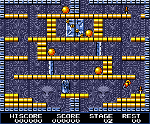<figcaption>Stage 2 - MSX2</figcaption></figure>
<figure>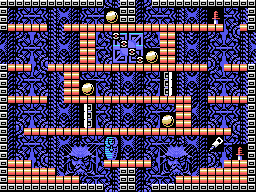<figcaption>Stage 2 - MSX</figcaption></figure>

<figure>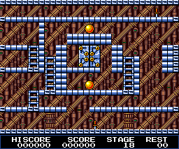<figcaption>Stage 18 - MSX2</figcaption></figure>
<figure>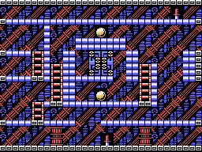<figcaption>Stage 18 - MSX</figcaption></figure>

<figure>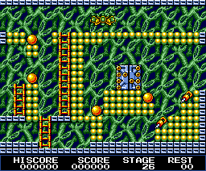<figcaption>Stage 26 - MSX2</figcaption></figure>
<figure>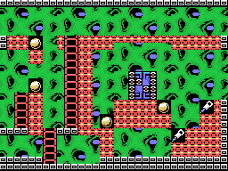<figcaption>Stage 26 - MSX</figcaption></figure>

<figure>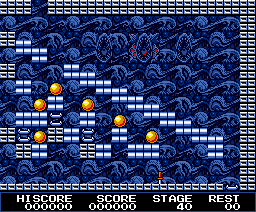<figcaption>Stage 40 - MSX2</figcaption></figure>
<figure>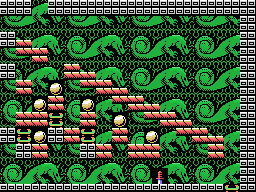<figcaption>Stage 40 - MSX</figcaption></figure>

<figure>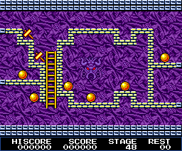<figcaption>Stage 48 - MSX2</figcaption></figure>
<figure>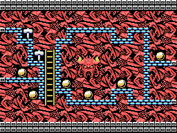<figcaption>Stage 48 - MSX</figcaption></figure>

<figure>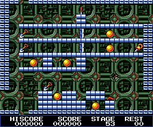<figcaption>Stage 53 - MSX2</figcaption></figure>
<figure>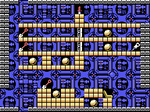<figcaption>Stage 53 - MSX</figcaption></figure>

## The menu and the password

START SELECT: NORMAL, PASSWORD or STAGE LOAD (a stage made with the editor).

<figure>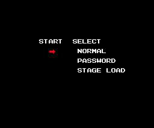<figcaption>The menu - MSX2</figcaption></figure>
<figure>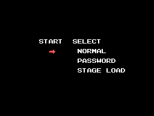<figcaption>The menu - MSX</figcaption></figure>

<figure>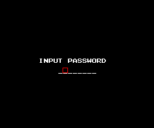<figcaption>The password - MSX2</figcaption></figure>
<figure>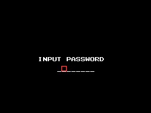<figcaption>The password - MSX</figcaption></figure>

## The editor

<figure>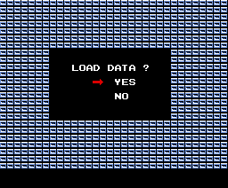<figcaption>The editor - MSX2</figcaption></figure>
<figure>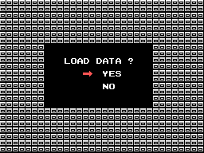<figcaption>The editor - MSX</figcaption></figure>

<figure>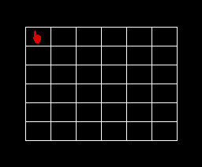<figcaption>The editor - MSX2</figcaption></figure>
<figure>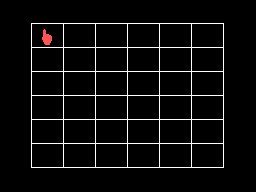<figcaption>The editor - MSX</figcaption></figure>

## Pyramid cleared

The map with the six pyramids and a different message for each one (from 1 to 5): HOLD OUT!!, TRY TO TAKE A NEW STEP FORWARD, HEAVEN KNOWS WHEN THIS GAME WILL END, OH! MY GOD! I BELIEVE IN GOD, AT LONG LAST FINAL COUNT DOWN.

<figure>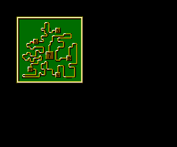<figcaption>Pyramid cleared - MSX2</figcaption></figure>
<figure>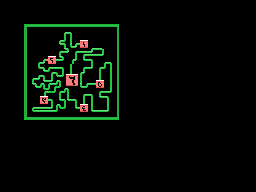<figcaption>Pyramid cleared - MSX</figcaption></figure>

<figure>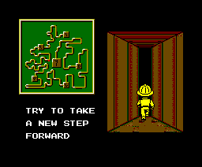<figcaption>Pyramid cleared - MSX2</figcaption></figure>
<figure><figcaption>Pyramid cleared - MSX</figcaption></figure>

<figure><figcaption>Pyramid cleared - MSX2</figcaption></figure>
<figure>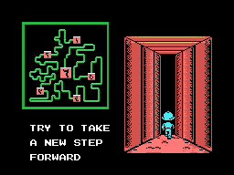<figcaption>Pyramid cleared - MSX</figcaption></figure>

<figure>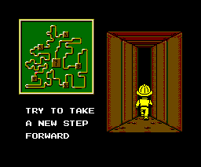<figcaption>Pyramid cleared - MSX2</figcaption></figure>
<figure>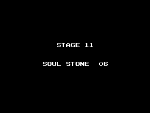<figcaption>Pyramid cleared - MSX</figcaption></figure>

## Game over

<figure>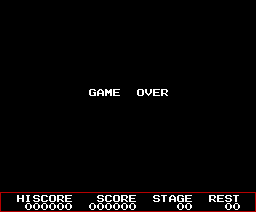<figcaption>Game over - MSX2</figcaption></figure>
<figure>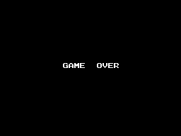<figcaption>Game over - MSX</figcaption></figure>

## The ending

CONGRATULATIONS TO VICK XIII !, the world saved, the order to turn off the switch (DANGER !!!), the credits and THE END.

<figure><figcaption>The ending - MSX2</figcaption></figure>
<figure><figcaption>The ending - MSX</figcaption></figure>

<figure><figcaption>The ending - MSX2</figcaption></figure>
<figure>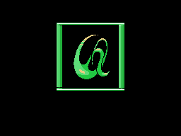<figcaption>The ending - MSX</figcaption></figure>

<figure>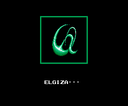<figcaption>The ending - MSX2</figcaption></figure>
<figure><figcaption>The ending - MSX</figcaption></figure>

<figure>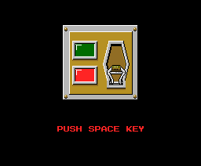<figcaption>The ending - MSX2</figcaption></figure>
<figure>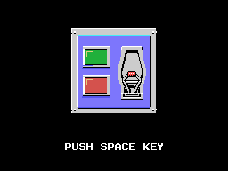<figcaption>The ending - MSX</figcaption></figure>

<figure>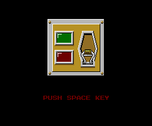<figcaption>The ending - MSX2</figcaption></figure>
<figure>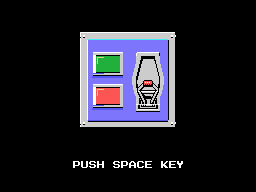<figcaption>The ending - MSX</figcaption></figure>

<figure>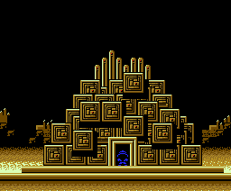<figcaption>The ending - MSX2</figcaption></figure>
<figure>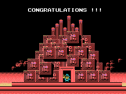<figcaption>The ending - MSX</figcaption></figure>

## The two hidden minigames

See [Curiosities](CURIOSITIES.html).

<figure>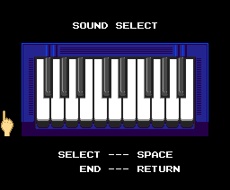<figcaption>SOUND SELECT - MSX2</figcaption></figure>
<figure>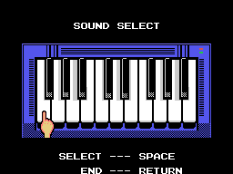<figcaption>SOUND SELECT - MSX</figcaption></figure>

<figure>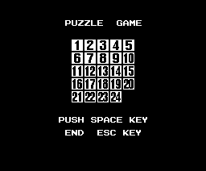<figcaption>PUZZLE GAME - MSX2</figcaption></figure>
<figure>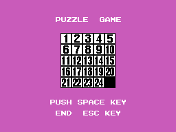<figcaption>PUZZLE GAME - MSX</figcaption></figure>

