# Las pirámides

Seis pirámides de diez fases cada una: **60 fases**. Se juegan en orden; al acabar la décima de cada pirámide sale el plano del juego con la siguiente, y tras la sexta, el final.

Cada fase es una rejilla de pantallas (de una a seis; las fases 44 y 60 tienen seis). Para salir hay que coger todas las joyas (SOUL STONE): con la última suena la música de la salida, el borde parpadea y la puerta se abre (`p02:99E2`).

Los mapas están **pintados ejecutando el cartucho**: el juego prepara la fase (`p00:5C80`) y pinta cada pantalla (`p00:5CF5`), y cada una se pone en su sitio de la rejilla que deja en `0xE788`. En MSX2 son de 16 colores con su paleta; en MSX1, de SCREEN 2. Los mapas son los mismos en los dos cartuchos (bancos 10 y 11, comunes); cambian los dibujos. A la izquierda MSX2, a la derecha MSX.

## Pirámide 1 (fases 1-10)

<figure>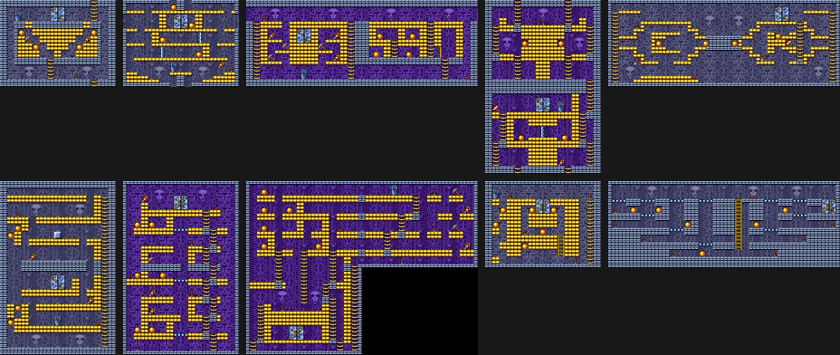<figcaption>Pirámide 1 - MSX2</figcaption></figure>
<figure>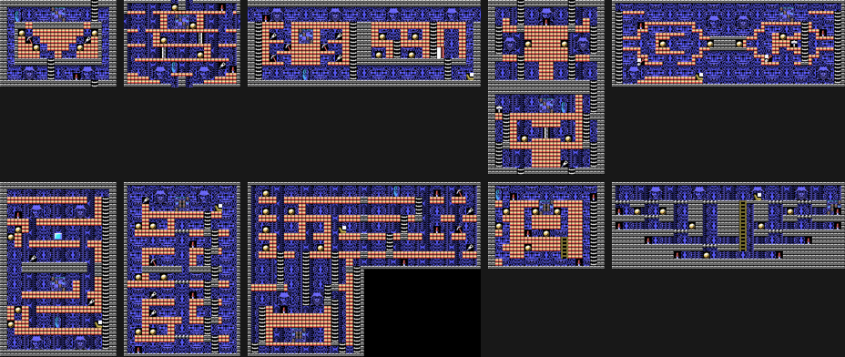<figcaption>Pirámide 1 - MSX</figcaption></figure>

### Fase 1

*1 pantalla.*

<figure><figcaption>Fase 1 - MSX2</figcaption></figure>
<figure><figcaption>Fase 1 - MSX</figcaption></figure>

### Fase 2

*1 pantalla.*

<figure>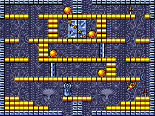<figcaption>Fase 2 - MSX2</figcaption></figure>
<figure>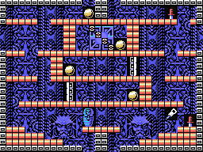<figcaption>Fase 2 - MSX</figcaption></figure>

### Fase 3

*2 pantallas.*

<figure>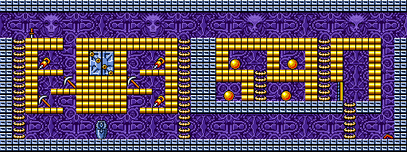<figcaption>Fase 3 - MSX2</figcaption></figure>
<figure>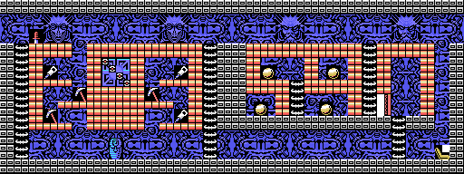<figcaption>Fase 3 - MSX</figcaption></figure>

### Fase 4

*2 pantallas.*

<figure>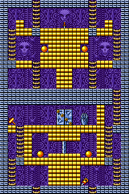<figcaption>Fase 4 - MSX2</figcaption></figure>
<figure>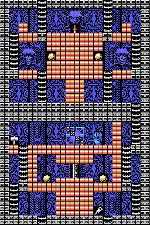<figcaption>Fase 4 - MSX</figcaption></figure>

### Fase 5

*2 pantallas.*

<figure>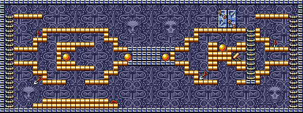<figcaption>Fase 5 - MSX2</figcaption></figure>
<figure>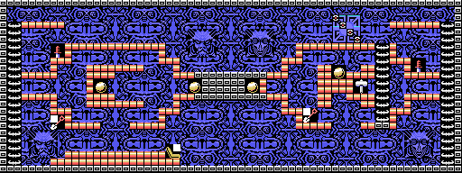<figcaption>Fase 5 - MSX</figcaption></figure>

### Fase 6

*2 pantallas.*

<figure>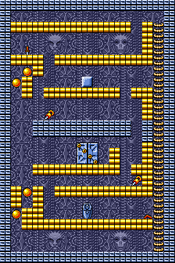<figcaption>Fase 6 - MSX2</figcaption></figure>
<figure>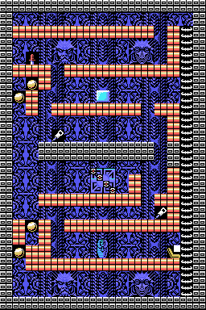<figcaption>Fase 6 - MSX</figcaption></figure>

### Fase 7

*2 pantallas.*

<figure>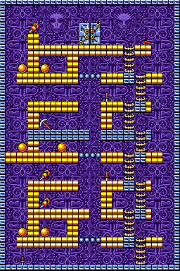<figcaption>Fase 7 - MSX2</figcaption></figure>
<figure>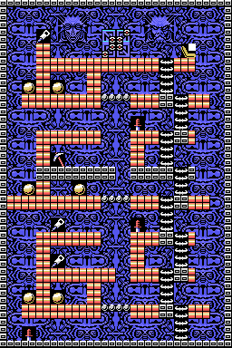<figcaption>Fase 7 - MSX</figcaption></figure>

### Fase 8

*3 pantallas.*

<figure>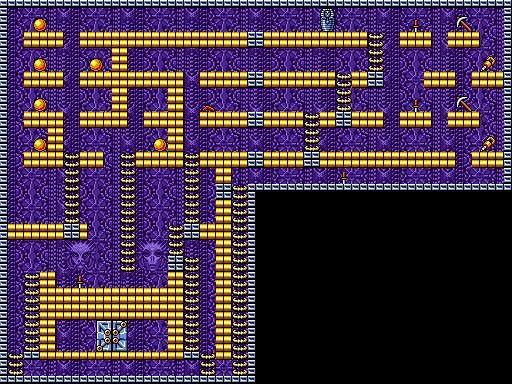<figcaption>Fase 8 - MSX2</figcaption></figure>
<figure>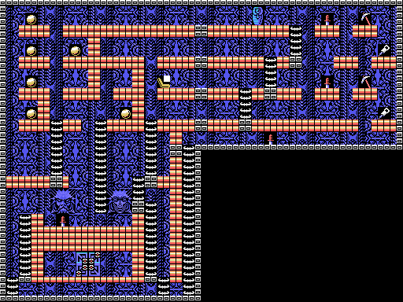<figcaption>Fase 8 - MSX</figcaption></figure>

### Fase 9

*1 pantalla.*

<figure><figcaption>Fase 9 - MSX2</figcaption></figure>
<figure>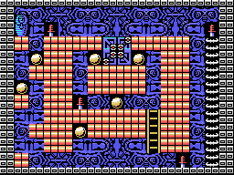<figcaption>Fase 9 - MSX</figcaption></figure>

### Fase 10

*2 pantallas.*

<figure>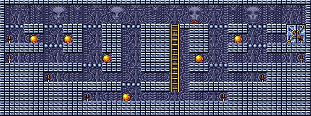<figcaption>Fase 10 - MSX2</figcaption></figure>
<figure>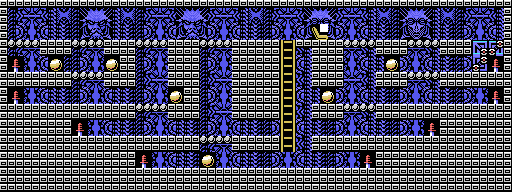<figcaption>Fase 10 - MSX</figcaption></figure>

## Pirámide 2 (fases 11-20)

<figure>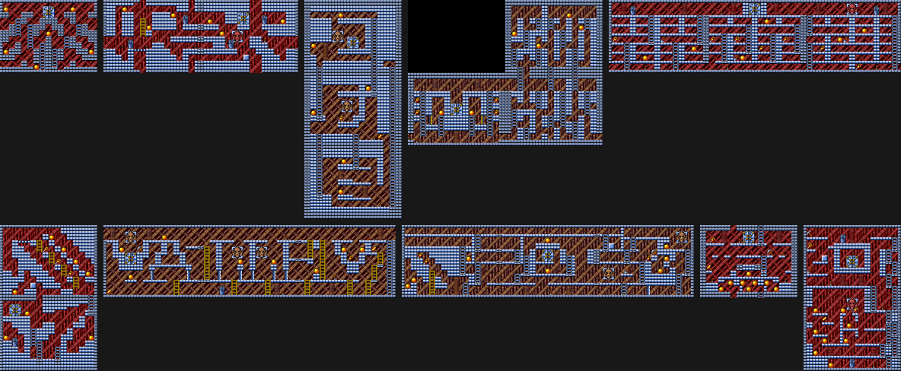<figcaption>Pirámide 2 - MSX2</figcaption></figure>
<figure>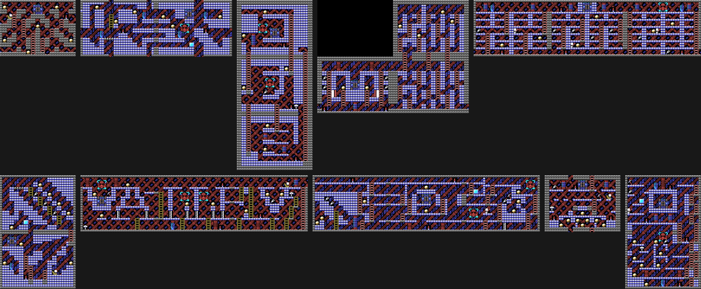<figcaption>Pirámide 2 - MSX</figcaption></figure>

### Fase 11

*1 pantalla.*

<figure><figcaption>Fase 11 - MSX2</figcaption></figure>
<figure><figcaption>Fase 11 - MSX</figcaption></figure>

### Fase 12

*2 pantallas.*

<figure>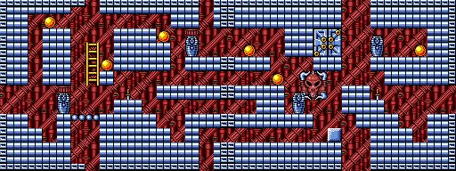<figcaption>Fase 12 - MSX2</figcaption></figure>
<figure>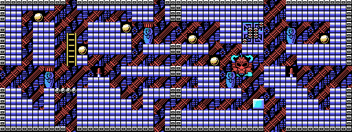<figcaption>Fase 12 - MSX</figcaption></figure>

### Fase 13

*3 pantallas.*

<figure>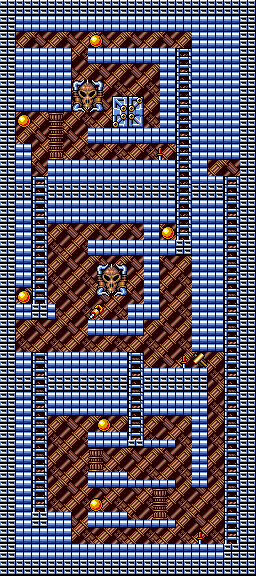<figcaption>Fase 13 - MSX2</figcaption></figure>
<figure>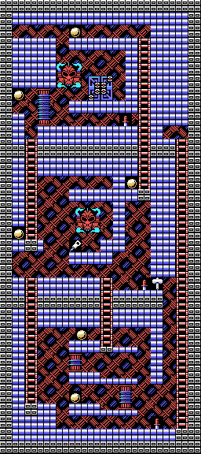<figcaption>Fase 13 - MSX</figcaption></figure>

### Fase 14

*3 pantallas.*

<figure>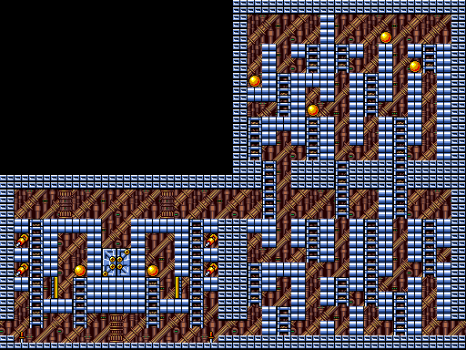<figcaption>Fase 14 - MSX2</figcaption></figure>
<figure>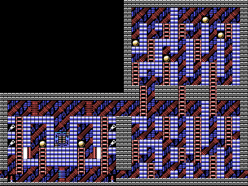<figcaption>Fase 14 - MSX</figcaption></figure>

### Fase 15

*3 pantallas.*

<figure>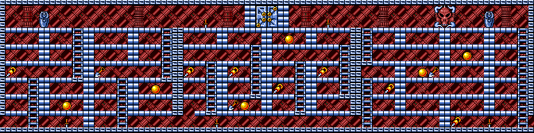<figcaption>Fase 15 - MSX2</figcaption></figure>
<figure>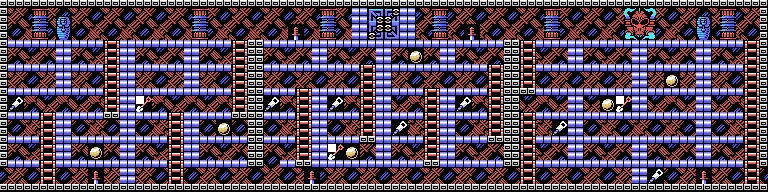<figcaption>Fase 15 - MSX</figcaption></figure>

### Fase 16

*2 pantallas.*

<figure>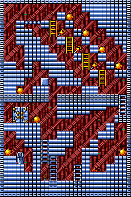<figcaption>Fase 16 - MSX2</figcaption></figure>
<figure>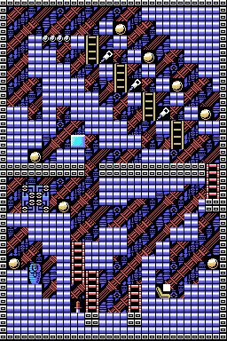<figcaption>Fase 16 - MSX</figcaption></figure>

### Fase 17

*3 pantallas.*

<figure>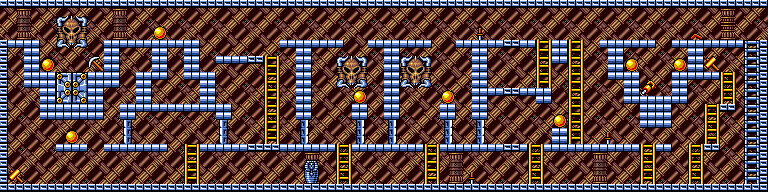<figcaption>Fase 17 - MSX2</figcaption></figure>
<figure>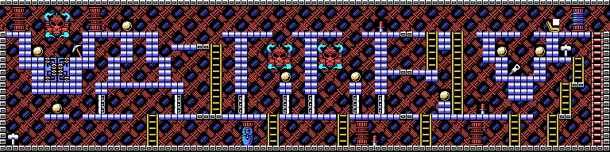<figcaption>Fase 17 - MSX</figcaption></figure>

### Fase 18

*3 pantallas.*

<figure>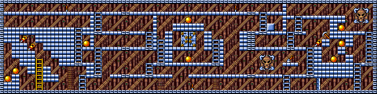<figcaption>Fase 18 - MSX2</figcaption></figure>
<figure>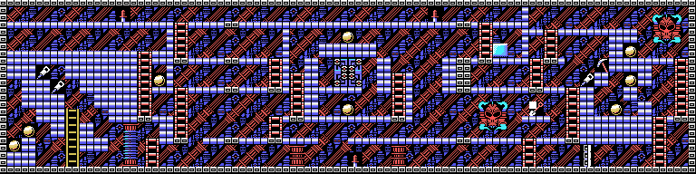<figcaption>Fase 18 - MSX</figcaption></figure>

### Fase 19

*1 pantalla.*

<figure><figcaption>Fase 19 - MSX2</figcaption></figure>
<figure>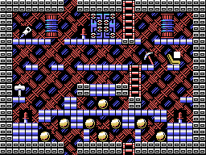<figcaption>Fase 19 - MSX</figcaption></figure>

### Fase 20

*2 pantallas.*

<figure>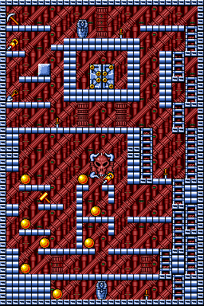<figcaption>Fase 20 - MSX2</figcaption></figure>
<figure>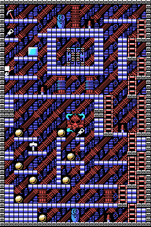<figcaption>Fase 20 - MSX</figcaption></figure>

## Pirámide 3 (fases 21-30)

<figure>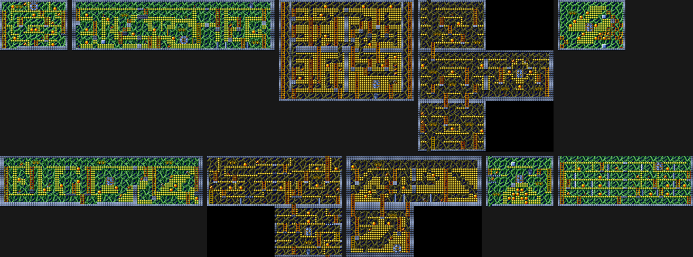<figcaption>Pirámide 3 - MSX2</figcaption></figure>
<figure>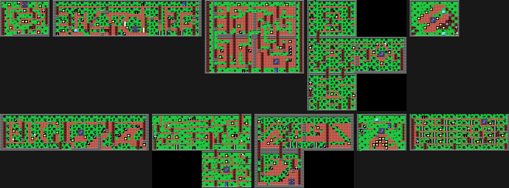<figcaption>Pirámide 3 - MSX</figcaption></figure>

### Fase 21

*1 pantalla.*

<figure><figcaption>Fase 21 - MSX2</figcaption></figure>
<figure>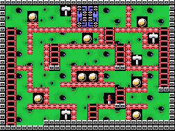<figcaption>Fase 21 - MSX</figcaption></figure>

### Fase 22

*3 pantallas.*

<figure>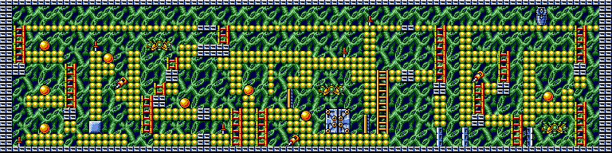<figcaption>Fase 22 - MSX2</figcaption></figure>
<figure>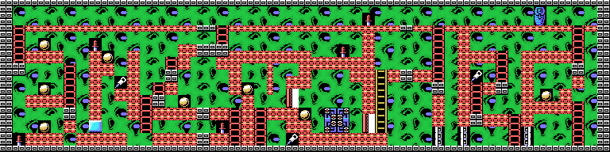<figcaption>Fase 22 - MSX</figcaption></figure>

### Fase 23

*4 pantallas.*

<figure>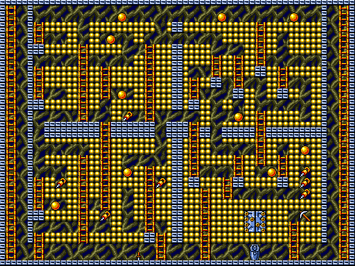<figcaption>Fase 23 - MSX2</figcaption></figure>
<figure>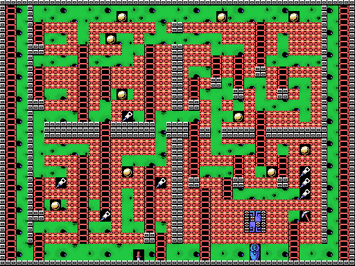<figcaption>Fase 23 - MSX</figcaption></figure>

### Fase 24

*4 pantallas.*

<figure>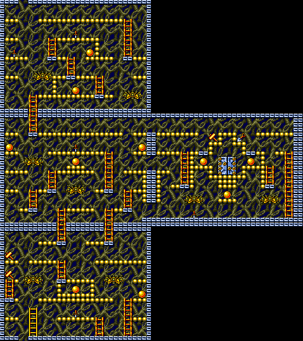<figcaption>Fase 24 - MSX2</figcaption></figure>
<figure>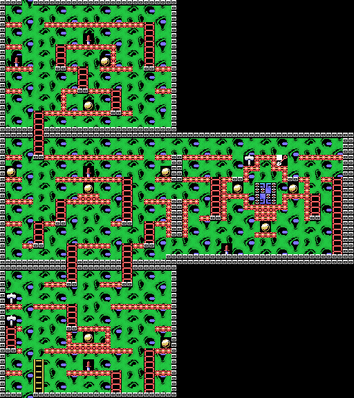<figcaption>Fase 24 - MSX</figcaption></figure>

### Fase 25

*1 pantalla.*

<figure>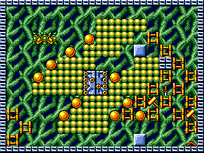<figcaption>Fase 25 - MSX2</figcaption></figure>
<figure><figcaption>Fase 25 - MSX</figcaption></figure>

### Fase 26

*3 pantallas.*

<figure>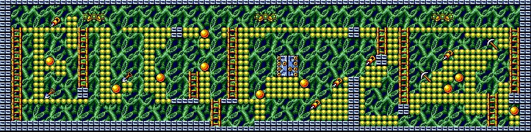<figcaption>Fase 26 - MSX2</figcaption></figure>
<figure>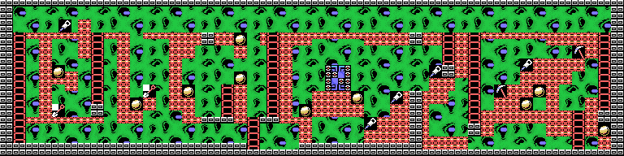<figcaption>Fase 26 - MSX</figcaption></figure>

### Fase 27

*3 pantallas.*

<figure><figcaption>Fase 27 - MSX2</figcaption></figure>
<figure><figcaption>Fase 27 - MSX</figcaption></figure>

### Fase 28

*3 pantallas.*

<figure><figcaption>Fase 28 - MSX2</figcaption></figure>
<figure><figcaption>Fase 28 - MSX</figcaption></figure>

### Fase 29

*1 pantalla.*

<figure><figcaption>Fase 29 - MSX2</figcaption></figure>
<figure><figcaption>Fase 29 - MSX</figcaption></figure>

### Fase 30

*2 pantallas.*

<figure><figcaption>Fase 30 - MSX2</figcaption></figure>
<figure><figcaption>Fase 30 - MSX</figcaption></figure>

## Pirámide 4 (fases 31-40)

<figure><figcaption>Pirámide 4 - MSX2</figcaption></figure>
<figure><figcaption>Pirámide 4 - MSX</figcaption></figure>

### Fase 31

*1 pantalla.*

<figure><figcaption>Fase 31 - MSX2</figcaption></figure>
<figure><figcaption>Fase 31 - MSX</figcaption></figure>

### Fase 32

*3 pantallas.*

<figure><figcaption>Fase 32 - MSX2</figcaption></figure>
<figure><figcaption>Fase 32 - MSX</figcaption></figure>

### Fase 33

*3 pantallas.*

<figure><figcaption>Fase 33 - MSX2</figcaption></figure>
<figure><figcaption>Fase 33 - MSX</figcaption></figure>

### Fase 34

*4 pantallas.*

<figure><figcaption>Fase 34 - MSX2</figcaption></figure>
<figure><figcaption>Fase 34 - MSX</figcaption></figure>

### Fase 35

*4 pantallas.*

<figure><figcaption>Fase 35 - MSX2</figcaption></figure>
<figure><figcaption>Fase 35 - MSX</figcaption></figure>

### Fase 36

*4 pantallas.*

<figure><figcaption>Fase 36 - MSX2</figcaption></figure>
<figure><figcaption>Fase 36 - MSX</figcaption></figure>

### Fase 37

*4 pantallas.*

<figure><figcaption>Fase 37 - MSX2</figcaption></figure>
<figure><figcaption>Fase 37 - MSX</figcaption></figure>

### Fase 38

*4 pantallas.*

<figure><figcaption>Fase 38 - MSX2</figcaption></figure>
<figure><figcaption>Fase 38 - MSX</figcaption></figure>

### Fase 39

*1 pantalla.*

<figure><figcaption>Fase 39 - MSX2</figcaption></figure>
<figure><figcaption>Fase 39 - MSX</figcaption></figure>

### Fase 40

*4 pantallas.*

<figure><figcaption>Fase 40 - MSX2</figcaption></figure>
<figure><figcaption>Fase 40 - MSX</figcaption></figure>

## Pirámide 5 (fases 41-50)

<figure><figcaption>Pirámide 5 - MSX2</figcaption></figure>
<figure><figcaption>Pirámide 5 - MSX</figcaption></figure>

### Fase 41

*1 pantalla.*

<figure><figcaption>Fase 41 - MSX2</figcaption></figure>
<figure><figcaption>Fase 41 - MSX</figcaption></figure>

### Fase 42

*2 pantallas.*

<figure><figcaption>Fase 42 - MSX2</figcaption></figure>
<figure><figcaption>Fase 42 - MSX</figcaption></figure>

### Fase 43

*4 pantallas.*

<figure><figcaption>Fase 43 - MSX2</figcaption></figure>
<figure><figcaption>Fase 43 - MSX</figcaption></figure>

### Fase 44

*6 pantallas.*

<figure><figcaption>Fase 44 - MSX2</figcaption></figure>
<figure><figcaption>Fase 44 - MSX</figcaption></figure>

### Fase 45

*3 pantallas.*

<figure><figcaption>Fase 45 - MSX2</figcaption></figure>
<figure><figcaption>Fase 45 - MSX</figcaption></figure>

### Fase 46

*4 pantallas.*

<figure><figcaption>Fase 46 - MSX2</figcaption></figure>
<figure><figcaption>Fase 46 - MSX</figcaption></figure>

### Fase 47

*3 pantallas.*

<figure><figcaption>Fase 47 - MSX2</figcaption></figure>
<figure><figcaption>Fase 47 - MSX</figcaption></figure>

### Fase 48

*3 pantallas.*

<figure><figcaption>Fase 48 - MSX2</figcaption></figure>
<figure><figcaption>Fase 48 - MSX</figcaption></figure>

### Fase 49

*1 pantalla.*

<figure><figcaption>Fase 49 - MSX2</figcaption></figure>
<figure><figcaption>Fase 49 - MSX</figcaption></figure>

### Fase 50

*4 pantallas.*

<figure><figcaption>Fase 50 - MSX2</figcaption></figure>
<figure><figcaption>Fase 50 - MSX</figcaption></figure>

## Pirámide 6 (fases 51-60)

<figure><figcaption>Pirámide 6 - MSX2</figcaption></figure>
<figure><figcaption>Pirámide 6 - MSX</figcaption></figure>

### Fase 51

*1 pantalla.*

<figure><figcaption>Fase 51 - MSX2</figcaption></figure>
<figure><figcaption>Fase 51 - MSX</figcaption></figure>

### Fase 52

*2 pantallas.*

<figure><figcaption>Fase 52 - MSX2</figcaption></figure>
<figure><figcaption>Fase 52 - MSX</figcaption></figure>

### Fase 53

*3 pantallas.*

<figure><figcaption>Fase 53 - MSX2</figcaption></figure>
<figure><figcaption>Fase 53 - MSX</figcaption></figure>

### Fase 54

*2 pantallas.*

<figure><figcaption>Fase 54 - MSX2</figcaption></figure>
<figure><figcaption>Fase 54 - MSX</figcaption></figure>

### Fase 55

*2 pantallas.*

<figure><figcaption>Fase 55 - MSX2</figcaption></figure>
<figure><figcaption>Fase 55 - MSX</figcaption></figure>

### Fase 56

*1 pantalla.*

<figure><figcaption>Fase 56 - MSX2</figcaption></figure>
<figure><figcaption>Fase 56 - MSX</figcaption></figure>

### Fase 57

*2 pantallas.*

<figure><figcaption>Fase 57 - MSX2</figcaption></figure>
<figure><figcaption>Fase 57 - MSX</figcaption></figure>

### Fase 58

*2 pantallas.*

<figure><figcaption>Fase 58 - MSX2</figcaption></figure>
<figure><figcaption>Fase 58 - MSX</figcaption></figure>

### Fase 59

*4 pantallas.*

<figure><figcaption>Fase 59 - MSX2</figcaption></figure>
<figure><figcaption>Fase 59 - MSX</figcaption></figure>

### Fase 60

*6 pantallas.*

<figure><figcaption>Fase 60 - MSX2</figcaption></figure>
<figure><figcaption>Fase 60 - MSX</figcaption></figure>

