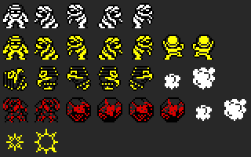
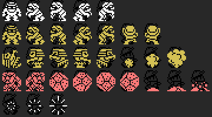

# Los enemigos

Cuatro, con los nombres del editor: **SLOUMAN, FLOUMAN, PYONCY y ROCK ROLL** (tipos 1 a 4: el editor guarda la opción del menú más uno, `p02:80D0`, y de ese tipo sale el enemigo, `p01:6741`). Salen de unos sitios fijos de cada fase (tabla del banco 13): cada sitio saca su enemigo a los 80 cuadros de empezar y, cuando ese se va, otro 192 cuadros después (`p01:671D`), si queda libre alguna de las ocho fichas de `0xE500`. Al matarlo pasa al tipo 5: suena `0x2D` y deja de hacer daño (`p01:6608`).

<figure><figcaption>SLOUMAN, FLOUMAN, PYONCY, ROCK ROLL y al morir - MSX2</figcaption></figure>
<figure><figcaption>SLOUMAN, FLOUMAN, PYONCY, ROCK ROLL y al morir - MSX</figcaption></figure>

Cada fila, un tipo (y la última, al morir), con los dibujos que se le han visto ejecutando las seis demostraciones y la fase 3 (la primera con FLOUMAN, que no sale en ninguna demostración), y con los colores que les pone el juego.

Lo que cambia de un cartucho al otro: al salir, en MSX1 cada uno tiene sus dibujos (PYONCY 24-26, ROCK ROLL 27-29); en MSX2 los dos salen con los mismos (24 y 25) y los mismos colores. Al morir, en MSX1 son tres dibujos (21-23) y en MSX2 dos (21 y 22).
