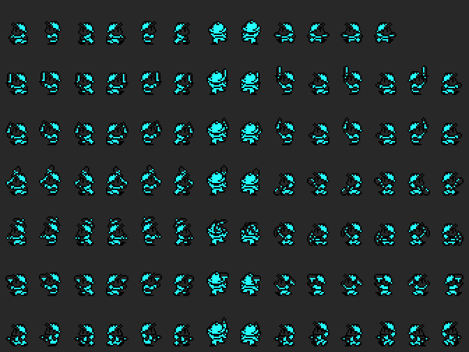
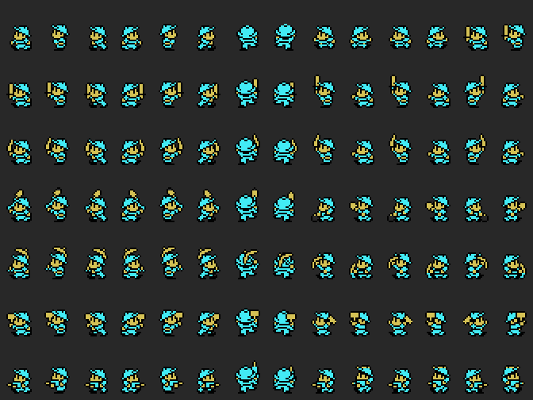
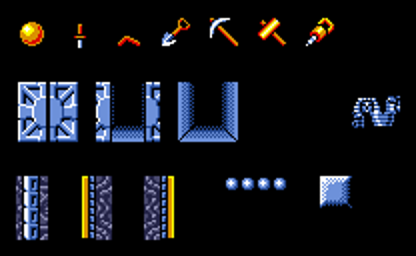
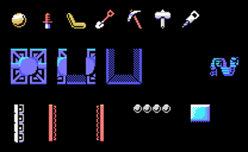

# Vick

Vick XIII lleva una herramienta como mucho: con una en la mano no coge otra (`p02:9A14`). Los nombres son los del editor de fases (banco 13):

- KNIFE y BOOMERANG se lanzan; el bumerán vuelve.
- SCOOP y PICK cavan hacia abajo.
- HAMMER y DRILL cavan hacia el lado.

<figure><figcaption>Vick - MSX2</figcaption></figure>
<figure><figcaption>Vick - MSX</figcaption></figure>

Cada fila es lo que lleva (`0xE287`: 0 nada, 1-6 las herramientas) y cada columna uno de sus 14 dibujos (`0xE285`), puestos por las rutinas del propio juego.

## Lo que hay en las fases

<figure><figcaption>Las cosas - MSX2</figcaption></figure>
<figure><figcaption>Las cosas - MSX</figcaption></figure>

La joya y las seis herramientas en el suelo, la puerta de salida en sus tres pasos al abrirse, el sitio del que salen los enemigos, las puertas giratorias (la de tipo 2 por sus dos lados), el suelo que se rompe y el bloque que se empuja. Todo pintado por las rutinas del juego.
